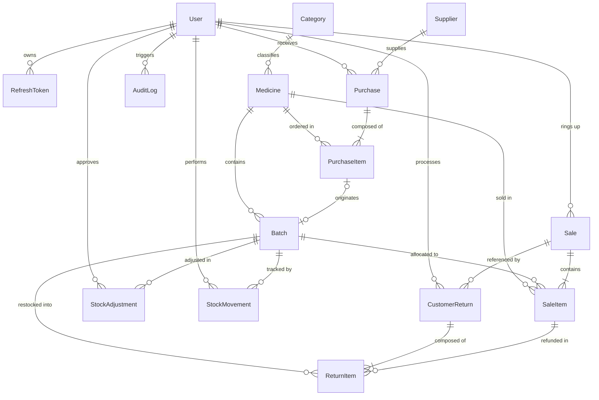

# Entity-Relationship Diagram (ERD) — PharmaPulse

> **System:** PharmaPulse Pharmacy Management System  
> **Database Engine:** PostgreSQL  
> **ORM:** Prisma 7  
> **Specification Version:** 1.0.0  

---

## 1. High-Level Entity Overview

The database design adheres to 3rd Normal Form (3NF) while ensuring full audibility and strict referential integrity. Financial and inventory ledgers are append-only to preserve legal accounting standards.

---

## 2. Detailed Attribute & Invariant Model

```mermaid
erDiagram
    User {
        UUID id PK
        VARCHAR email UK "indexed"
        VARCHAR passwordHash "Argon2id"
        VARCHAR fullName
        ENUM role "ADMIN | PHARMACIST | CASHIER"
        BOOLEAN isActive
        TIMESTAMPTZ createdAt
        TIMESTAMPTZ updatedAt
    }

    RefreshToken {
        UUID id PK
        UUID userId FK
        VARCHAR tokenHash "SHA-256"
        UUID familyId
        BOOLEAN isRevoked
        TIMESTAMPTZ expiresAt
        TIMESTAMPTZ createdAt
    }

    Category {
        UUID id PK
        VARCHAR name UK
        TEXT description
        TIMESTAMPTZ createdAt
        TIMESTAMPTZ updatedAt
    }

    Medicine {
        UUID id PK
        UUID categoryId FK
        VARCHAR name "indexed"
        VARCHAR genericName "indexed"
        VARCHAR sku UK
        VARCHAR dosageForm "Tablet | Capsule | Syrup..."
        VARCHAR strength "500mg | 10ml..."
        VARCHAR packageUnit "Strip of 10 | Bottle..."
        INT minReorderLevel "CHECK >= 0"
        DECIMAL defaultTaxRate "CHECK >= 0"
        BOOLEAN isActive
        TIMESTAMPTZ createdAt
        TIMESTAMPTZ updatedAt
    }

    Supplier {
        UUID id PK
        VARCHAR name "indexed"
        VARCHAR contactPerson
        VARCHAR phone
        VARCHAR email
        TEXT address
        VARCHAR taxNumber "GSTIN / VAT"
        BOOLEAN isActive
        TIMESTAMPTZ createdAt
        TIMESTAMPTZ updatedAt
    }

    Purchase {
        UUID id PK
        VARCHAR purchaseNumber UK
        UUID supplierId FK
        ENUM status "DRAFT | RECEIVED | CANCELLED"
        TIMESTAMPTZ orderedDate
        TIMESTAMPTZ receivedDate
        DECIMAL subtotal "CHECK >= 0"
        DECIMAL taxTotal "CHECK >= 0"
        DECIMAL grandTotal "CHECK >= 0"
        UUID receivedByUserId FK
        TEXT notes
        TIMESTAMPTZ createdAt
        TIMESTAMPTZ updatedAt
    }

    PurchaseItem {
        UUID id PK
        UUID purchaseId FK
        UUID medicineId FK
        VARCHAR batchNumber
        DATE manufacturingDate
        DATE expiryDate
        INT orderedQuantity "CHECK > 0"
        INT receivedQuantity "CHECK >= 0"
        DECIMAL unitCost "CHECK >= 0"
        DECIMAL unitSalePrice "CHECK >= 0"
        DECIMAL lineTotal "CHECK >= 0"
    }

    Batch {
        UUID id PK
        UUID medicineId FK
        VARCHAR batchNumber
        UUID purchaseItemId FK
        DATE manufacturingDate
        DATE expiryDate "indexed"
        INT initialQuantity "CHECK >= 0"
        INT currentQuantity "CHECK >= 0, indexed"
        DECIMAL purchaseCost "CHECK >= 0"
        DECIMAL salePrice "CHECK >= 0"
        DECIMAL mrp "CHECK >= 0"
        ENUM status "ACTIVE | QUARANTINED | DEPLETED | EXPIRED"
        TIMESTAMPTZ createdAt
        TIMESTAMPTZ updatedAt
    }

    StockMovement {
        UUID id PK
        UUID batchId FK
        ENUM movementType "PURCHASE_RECEIPT | SALE_DEDUCTION | CUSTOMER_RETURN | ADJUSTMENT_WRITE_OFF | ADJUSTMENT_RESTOCK | EXPIRED_DISPOSAL"
        INT quantityDelta "Positive or Negative"
        INT balanceAfter "CHECK >= 0"
        UUID referenceId "Sale, Purchase, Return or Adjustment ID"
        UUID performedByUserId FK
        TEXT reason "Mandatory for adjustments/returns"
        TIMESTAMPTZ createdAt "indexed"
    }

    Sale {
        UUID id PK
        VARCHAR invoiceNumber UK
        UUID cashierId FK
        VARCHAR customerName
        VARCHAR customerPhone
        DECIMAL subtotal "CHECK >= 0"
        DECIMAL discountAmount "CHECK >= 0"
        DECIMAL taxAmount "CHECK >= 0"
        DECIMAL totalAmount "CHECK >= 0"
        ENUM paymentMethod "CASH | CARD | UPI | SPLIT"
        ENUM status "COMPLETED | REFUNDED_PARTIAL | REFUNDED_FULL | CANCELLED"
        VARCHAR idempotencyKey UK
        TIMESTAMPTZ createdAt "indexed"
        TIMESTAMPTZ updatedAt
    }

    SaleItem {
        UUID id PK
        UUID saleId FK
        UUID medicineId FK
        UUID batchId FK
        INT quantity "CHECK > 0"
        DECIMAL unitPrice "Snapshot, CHECK >= 0"
        DECIMAL costPrice "Snapshot, CHECK >= 0"
        DECIMAL taxRate "Snapshot, CHECK >= 0"
        DECIMAL taxAmount "Snapshot, CHECK >= 0"
        DECIMAL totalAmount "Snapshot, CHECK >= 0"
    }

    CustomerReturn {
        UUID id PK
        VARCHAR returnNumber UK
        UUID saleId FK
        UUID processedByUserId FK
        TEXT reason
        DECIMAL refundAmount "CHECK >= 0"
        TIMESTAMPTZ createdAt
    }

    ReturnItem {
        UUID id PK
        UUID returnId FK
        UUID saleItemId FK
        UUID batchId FK
        INT quantity "CHECK > 0"
        DECIMAL refundAmount "CHECK >= 0"
        ENUM disposition "RESTOCKED | DAMAGED_DISCARDED"
    }

    StockAdjustment {
        UUID id PK
        VARCHAR adjustmentNumber UK
        UUID batchId FK
        ENUM adjustmentType "WRITE_OFF_DAMAGED | WRITE_OFF_EXPIRED | INVENTORY_COUNT_GAIN | INVENTORY_COUNT_LOSS"
        INT quantityDelta
        TEXT reason
        UUID approvedByUserId FK
        TIMESTAMPTZ createdAt
    }

    AuditLog {
        UUID id PK
        UUID actorId FK
        VARCHAR action
        VARCHAR entityName
        VARCHAR entityId
        VARCHAR ipAddress
        TEXT userAgent
        JSONB diff
        TIMESTAMPTZ createdAt "indexed"
    }
```

---

## 3. Database Indexes & Constraints Summary

| Table | Index / Constraint | Purpose |
| :--- | :--- | :--- |
| `User` | `UNIQUE(email)` | Prevent duplicate credentials |
| `Medicine` | `UNIQUE(sku)` | Ensure barcode / SKU uniqueness |
| `Medicine` | `INDEX(name, genericName)` | Fast search during POS checkout |
| `Batch` | `UNIQUE(medicineId, batchNumber)` | Prevent duplicate batch entry per drug |
| `Batch` | `INDEX(expiryDate, currentQuantity)` | Accelerate FEFO allocation query |
| `Batch` | `CHECK(currentQuantity >= 0)` | Enforce no-negative inventory rule |
| `Sale` | `UNIQUE(invoiceNumber)` | Guarantee fiscal invoice sequence |
| `Sale` | `INDEX(createdAt)` | Fast sales reporting by date range |
| `StockMovement` | `INDEX(batchId, createdAt)` | Rapid ledger reconciliation queries |
| `StockMovement` | `CHECK(balanceAfter >= 0)` | Invariant: ledger balance never drops below zero |
